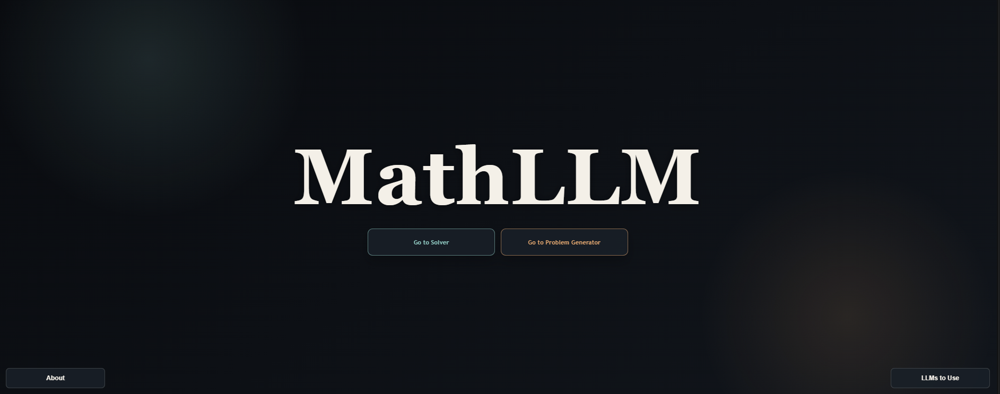

# MathLLM

### An AI-powered mathematics assistant built with Django to help users generate, solve, and explore math problems with the support of AI agents.

## Overview

MathLLM is a web application designed to assist students and math enthusiasts with AI-driven problem generation and solving. The app combines a Django backend with an interactive frontend to provide an easy-to-use experience for generating practice questions, solving math problems, and exploring AI-assisted learning tools.

This project is ideal for:

- Generating custom math exercises
- Solving mathematical problems with AI assistance
- Building educational tools powered by LLMs
- Learning how to combine Django, AI APIs, and web interfaces

## Features

- AI-assisted math problem generation
- Problem solving support with LLM integration
- Multiple app pages for different learning workflows
- Clean, responsive web design
- Django-based backend architecture
- Custom prompts for math-related tasks

## Local Ollama setup

The solver uses a local Ollama service for image transcription and solution
generation. Start the Ollama app (or run `ollama serve`) before submitting a
problem; the default API address is `http://localhost:11434`. If Ollama is
running elsewhere, set `OLLAMA_HOST` to its API address. The solver needs the
`qwen2.5vl` vision model and the `deepseek-r1:latest` text model; install them
with `ollama pull qwen2.5vl` and `ollama pull deepseek-r1:latest`.

As for the generator this is still under development.